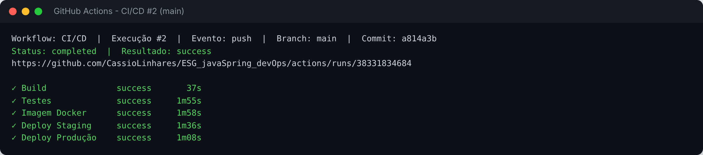
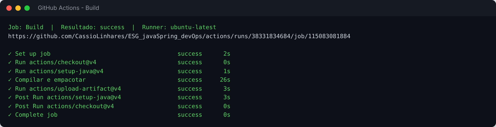
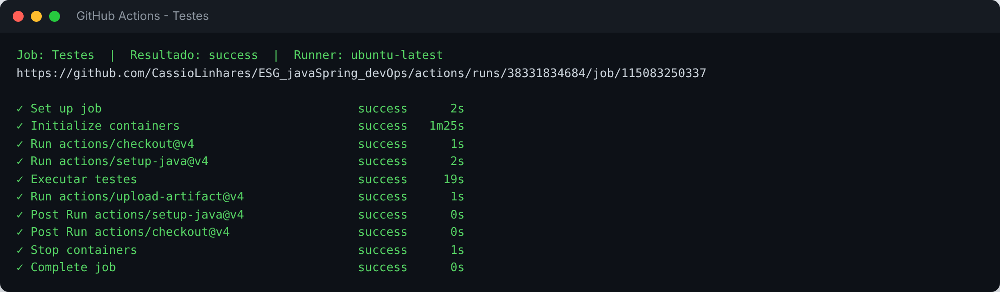
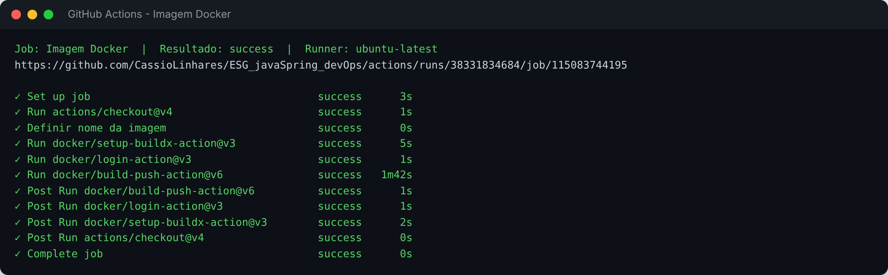
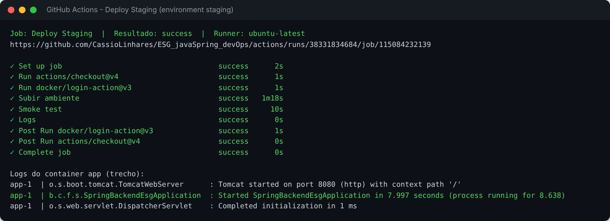
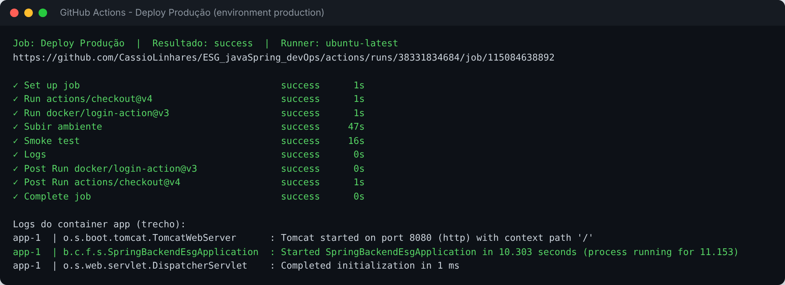
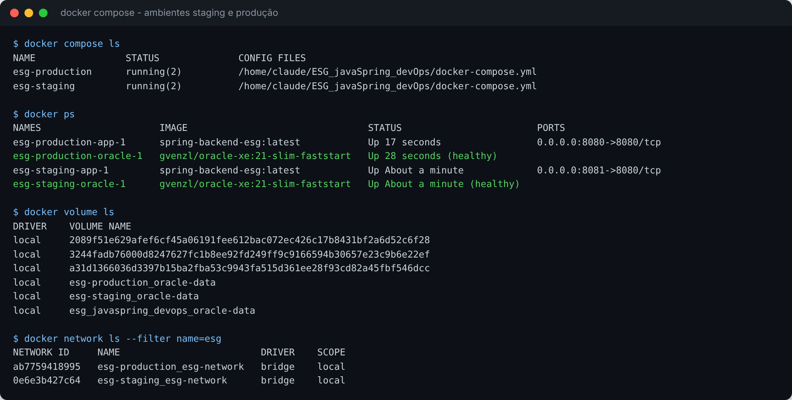
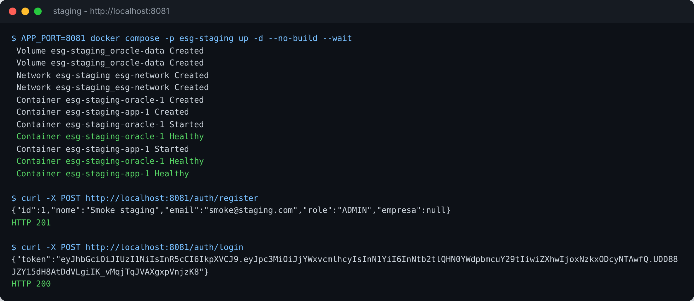
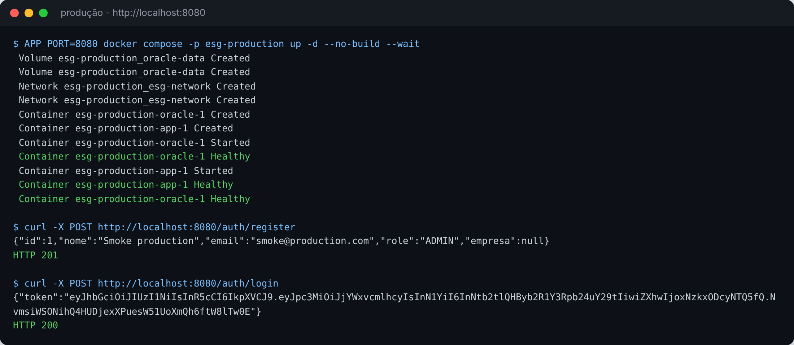

# Projeto - Cidades ESGInteligentes

API REST em Java com Spring Boot para gerenciamento de empresas, setores, equipamentos, consumos de energia, alertas e usuarios, com autenticacao JWT e controle de acesso por perfil. O projeto conta com pipeline de CI/CD no GitHub Actions, imagem Docker e orquestração com Docker Compose para os ambientes de staging e produção.

## Como executar localmente com Docker

Pré-requisitos: Docker e Docker Compose instalados.

1. Clone o repositório e entre na pasta do projeto:

```bash
git clone https://github.com/CassioLinhares/ESG_javaSpring_devOps.git
cd ESG_javaSpring_devOps
```

2. Crie o arquivo de variáveis de ambiente a partir do modelo:

```bash
cp .env.example .env
```

3. Gere a imagem e suba a aplicação com o banco:

```bash
docker compose up -d --build
```

4. Acompanhe os serviços até o Oracle ficar `healthy` e a aplicação iniciar:

```bash
docker compose ps
docker compose logs -f app
```

5. Teste a API em `http://localhost:8080`:

```bash
curl -X POST http://localhost:8080/auth/register -H "Content-Type: application/json" -d '{"nome":"Admin","email":"admin@example.com","senha":"123456","role":"ADMIN"}'
curl -X POST http://localhost:8080/auth/login -H "Content-Type: application/json" -d '{"email":"admin@example.com","senha":"123456"}'
```

6. Para encerrar o ambiente:

```bash
docker compose down
```

Para apagar também os dados do banco:

```bash
docker compose down -v
```

Para simular os dois ambientes na mesma máquina, cada um com seu próprio banco, volume e rede:

```bash
APP_PORT=8081 docker compose -p esg-staging up -d --build
APP_PORT=8080 docker compose -p esg-production up -d
```

### Serviços do Compose

| Recurso | Descrição |
| --- | --- |
| `oracle` | Banco Oracle XE 21 com o usuário da aplicação criado no PDB `XEPDB1` |
| `app` | API Spring Boot, iniciada somente após o banco ficar saudável |
| `oracle-data` | Volume nomeado com os dados do banco |
| `esg-network` | Rede bridge usada na comunicação entre os serviços |

### Variáveis de ambiente

| Variável | Uso | Padrão |
| --- | --- | --- |
| `APP_IMAGE` | Imagem da aplicação | `spring-backend-esg:latest` |
| `APP_PORT` | Porta exposta no host | `8080` |
| `ORACLE_PASSWORD` | Senha do `SYSTEM` do Oracle | `oracle` |
| `DB_USER` | Usuário da aplicação no banco | `esg` |
| `DB_PASSWORD` | Senha do usuário da aplicação | `esg123` |
| `JWT_SECRET` | Chave de assinatura do JWT | `troque-esta-chave` |

A aplicação recebe a conexão e a chave JWT pelas variáveis `SPRING_DATASOURCE_URL`, `SPRING_DATASOURCE_USERNAME`, `SPRING_DATASOURCE_PASSWORD` e `MINHA_PALAVRA_SECRETA`, preenchidas pelo `docker-compose.yml`.

## Pipeline CI/CD

**Ferramentas:** GitHub Actions, Maven Wrapper, Docker Buildx, GitHub Container Registry (GHCR), GitHub Environments e Docker Compose.

O pipeline fica em `.github/workflows/ci-cd.yml` e é disparado a cada push e pull request para a `main`, ou manualmente pela aba Actions (`workflow_dispatch`).

```text
Build ──> Testes ──> Imagem Docker ──> Deploy Staging ──> Deploy Produção
```

| Etapa | O que faz |
| --- | --- |
| `Build` | Configura o JDK 21 com cache do Maven, compila e empacota a aplicação com `./mvnw package` e publica o `.jar` como artefato |
| `Testes` | Sobe um Oracle XE como service container e executa `./mvnw test`. O teste carrega o contexto do Spring e aplica as migrations do Flyway no banco. Os relatórios do Surefire ficam como artefato |
| `Imagem Docker` | Gera a imagem pelo `Dockerfile` com cache do GitHub Actions e, fora de pull requests, publica no GHCR com as tags do commit e `latest` |
| `Deploy Staging` | Usa o environment `staging`, baixa a imagem do commit no GHCR, sobe a aplicação com o Docker Compose e executa um smoke test de cadastro e login |
| `Deploy Produção` | Usa o environment `production` e só roda depois do staging concluir com sucesso, repetindo o deploy e o smoke test |

**Funcionamento:**

- Cada etapa depende da anterior (`needs`), então uma falha no build ou nos testes interrompe o pipeline antes de gerar imagem ou fazer deploy.
- Em pull requests rodam build, testes e a geração da imagem, sem publicar nem fazer deploy.
- Em push na `main` a imagem é publicada e os deploys acontecem em sequência: primeiro staging, depois produção.
- Os deploys sobem o `docker-compose.yml` no runner do GitHub, cada ambiente com seu projeto Compose, banco, volume, rede e porta (`8081` em staging e `8080` em produção).
- Os environments `staging` e `production` podem ser configurados em Settings > Environments. Neles é possível exigir aprovação manual antes do deploy e cadastrar os secrets `ORACLE_PASSWORD`, `DB_PASSWORD` e `JWT_SECRET` e a variável `DB_USER`. Sem esses valores o pipeline usa os padrões do `.env.example`.

## Containerização

```dockerfile
FROM eclipse-temurin:21-jdk AS build
WORKDIR /workspace
COPY .mvn .mvn
COPY mvnw pom.xml ./
RUN chmod +x mvnw && ./mvnw -B -q dependency:go-offline
COPY src src
RUN ./mvnw -B -q package -DskipTests

FROM eclipse-temurin:21-jre
LABEL authors="cassio linhares"
WORKDIR /app
RUN groupadd --system spring && useradd --system --gid spring spring
COPY --from=build /workspace/target/spring_backend_esg-0.0.1-SNAPSHOT.jar app.jar
USER spring
VOLUME /tmp
EXPOSE 8080
ENTRYPOINT ["java", "-jar", "app.jar"]
```

**Estratégias adotadas:**

- **Multi-stage build:** a primeira etapa compila com o JDK e o Maven Wrapper, a segunda leva apenas o `.jar` para uma imagem JRE, que é menor e não carrega ferramentas de build.
- **Cache de dependências:** `pom.xml` e o wrapper são copiados antes do código, então as dependências só são baixadas de novo quando o `pom.xml` muda.
- **Usuário sem privilégios:** a aplicação roda com o usuário `spring`, e não como root.
- **Build independente da máquina:** não é preciso gerar o `.jar` antes do `docker build`.
- **`.dockerignore`:** deixa `target`, `.git`, arquivos de IDE e o `.env` fora do contexto da imagem.
- **Configuração por ambiente:** nenhuma credencial fica na imagem; banco e JWT chegam por variáveis de ambiente.

Para gerar a imagem manualmente:

```bash
docker build -t spring-backend-esg .
```

## Prints do funcionamento

Execuções do pipeline no GitHub Actions: [workflow CI/CD](https://github.com/CassioLinhares/ESG_javaSpring_devOps/actions/workflows/ci-cd.yml)

Execução com deploy em staging e produção: [CI/CD #2 na main](https://github.com/CassioLinhares/ESG_javaSpring_devOps/actions/runs/38331834684)

Documentação técnica com as evidências: [docs/documentacao-tecnica.pdf](docs/documentacao-tecnica.pdf)

### Pipeline



### Build



### Testes



### Imagem Docker



### Deploy em staging



### Deploy em produção



### Ambientes com Docker Compose







## Tecnologias utilizadas

| Categoria | Tecnologias |
| --- | --- |
| Linguagem | Java 21 |
| Framework | Spring Boot 4 (Spring Web MVC, Spring Security, Spring Data JPA, Bean Validation) |
| Banco de dados | Oracle Database (Oracle XE 21 nos containers) |
| Migrations | Flyway |
| Autenticação | JWT com `java-jwt` |
| Build | Maven Wrapper |
| Testes | JUnit 5 e Spring Boot Test |
| Utilitários | Lombok |
| Containerização | Docker (multi-stage) e Docker Compose |
| CI/CD | GitHub Actions, GitHub Environments e GitHub Container Registry |

## Banco De Dados

O projeto usa Flyway para versionamento do banco. As migrations ficam em:

```text
src/main/resources/db/migration
```

As tabelas versionadas são:

- `tbl_usuario`
- `tbl_empresa`
- `tbl_setor`
- `tbl_equipamento`
- `tbl_consumo_energia`
- `tbl_alerta`

Atualmente o banco foi zerado e mantem apenas a tabela de usuários com três usuários iniciais:

| Perfil | Email | Senha |
| --- | --- | --- |
| Admin | `admin@example.com` | `123456` |
| Usuario | `user@example.com` | `123456` |
| Operador | `operador@example.com` | `123456` |

## Configuração

As configurações principais ficam em:

```text
src/main/resources/application.properties
```

Confira os dados de conexão do Oracle antes de executar:

```properties
spring.datasource.url=jdbc:oracle:thin:@oracle.fiap.com.br:1521:ORCL
spring.datasource.username=RM565388
spring.datasource.password=fiap26
```

## Como Executar Sem Docker

No terminal, na raiz do projeto:

```bash
./mvnw spring-boot:run
```

No Windows:

```bash
.\mvnw.cmd spring-boot:run
```

A API sobe por padrao em:

```text
http://localhost:8080
```

## Autenticação

Para acessar as rotas protegidas, faça login em:

```http
POST /auth/login
```

Exemplo:

```json
{
  "email": "admin@example.com",
  "senha": "123456"
}
```

A resposta retorna um token JWT:

```json
{
  "token": "..."
}
```

Use esse token nas rotas protegidas:

```http
Authorization: Bearer SEU_TOKEN
```

## Regras De Acesso

- `POST /auth/login`: publico
- `POST /auth/register`: publico
- `DELETE /api/**`: somente `ADMIN`
- `POST /api/**`: somente `ADMIN`
- `PUT /api/**`: somente `ADMIN`
- `POST /api/consumos-energia`: `ADMIN` ou `OPERADOR`
- `POST /api/alertas`: `ADMIN` ou `OPERADOR`
- Demais rotas `/api/**`: usuario autenticado

## Perfis De Acesso

| Perfil | Descricao |
| --- | --- |
| `ADMIN` | Acesso total: GET, POST, PUT e DELETE em todos os recursos |
| `OPERADOR` | Pode registrar consumos de energia e alertas |
| `USER` | Acesso somente leitura nos recursos da API |

## Fluxo Sugerido Para Teste

Como o banco foi zerado e possui apenas usuarios, cadastre os dados nesta ordem:

1. Criar empresa
2. Criar setor vinculado a empresa
3. Criar equipamento vinculado ao setor
4. Criar consumo de energia vinculado ao equipamento
5. Criar alerta vinculado ao setor

## Principais Rotas

### Auth

```http
POST /auth/login
POST /auth/register
```

### Usuarios

```http
GET /api/usuarios
GET /api/usuarios/{id}
GET /api/usuarios/?nome=Admin
POST /api/usuarios
PUT /api/usuarios
DELETE /api/usuarios/{id}
```

### Empresas

```http
GET /api/empresas
GET /api/empresas/{id}
GET /api/empresas/?name=Empresa ESG
POST /api/empresas
PUT /api/empresas
DELETE /api/empresas/{id}
```

### Setores

```http
GET /api/setores
GET /api/setores/{id}
GET /api/setores/?nome=Producao
POST /api/setores
PUT /api/setores
DELETE /api/setores/{id}
```

### Equipamentos

```http
GET /api/equipamentos
GET /api/equipamentos/{id}
GET /api/equipamentos/?nome=Motor
GET /api/equipamentos/?setorId=1
POST /api/equipamentos
PUT /api/equipamentos
DELETE /api/equipamentos/{id}
```

### Consumos De Energia

```http
GET /api/consumos-energia
GET /api/consumos-energia/{id}
GET /api/consumos-energia?equipamentoId=1
GET /api/consumos-energia/soma?setorId=1&inicio=2026-05-01T00:00:00&fim=2026-05-31T23:59:59
POST /api/consumos-energia
PUT /api/consumos-energia
DELETE /api/consumos-energia/{id}
```

Exemplo de cadastro:

```json
{
  "consumoKwh": 120.5,
  "equipamento": {
    "id": 1
  }
}
```

### Alertas

```http
GET /api/alertas
GET /api/alertas/{id}
GET /api/alertas/?setorId=1
POST /api/alertas
PUT /api/alertas
DELETE /api/alertas/{id}
```

Exemplo de cadastro:

```json
{
  "mensagem": "Equipamento consumindo alem da conta",
  "setor": {
    "id": 1
  }
}
```

## Lembre de conferir os dados:

1. Confirme a variavel `base_url` como `http://localhost:8080` no Insomnia.
2. Faca login em `/auth/login`.
3. Copie o token retornado.
4. Configure manualmente o Bearer Token nas requisicoes protegidas.

## Validação

Para compilar o projeto:

```bash
.\mvnw.cmd -DskipTests compile
```

Para executar os testes:

```bash
.\mvnw.cmd test
```

## Checklist de entrega

| Item | OK |
| --- | --- |
| Projeto compactado em .ZIP com estrutura organizada | OK |
| Dockerfile funcional | OK |
| docker-compose.yml ou arquivos Kubernetes | OK |
| Pipeline com etapas de build, teste e deploy | OK |
| README.md com instruções e prints | OK |
| Documentação técnica com evidências (PDF ou PPT) | OK |
| Deploy realizado nos ambientes staging e produção | OK |
